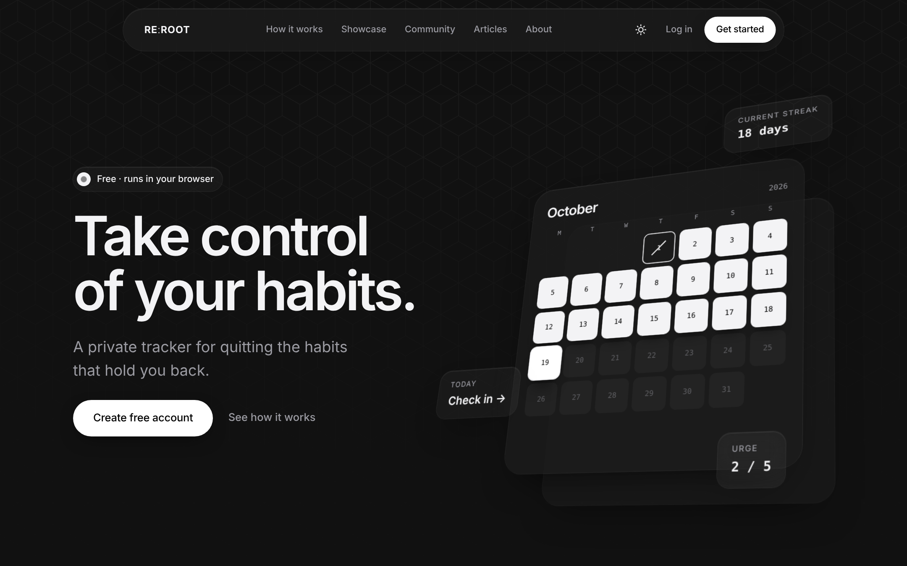
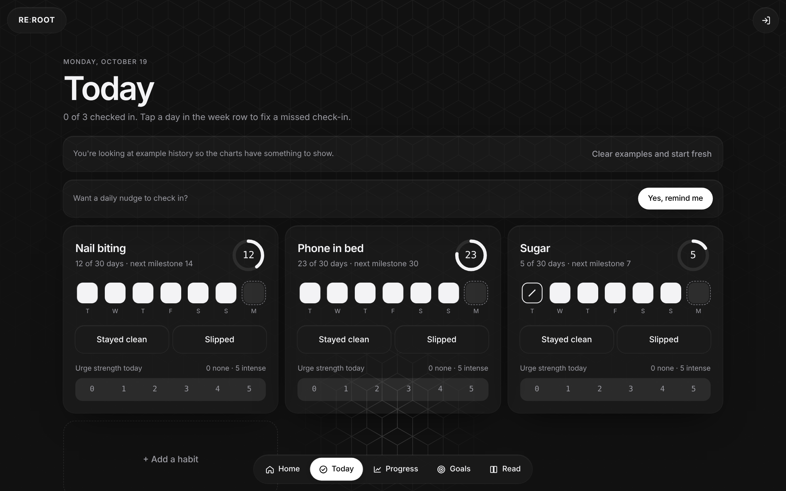
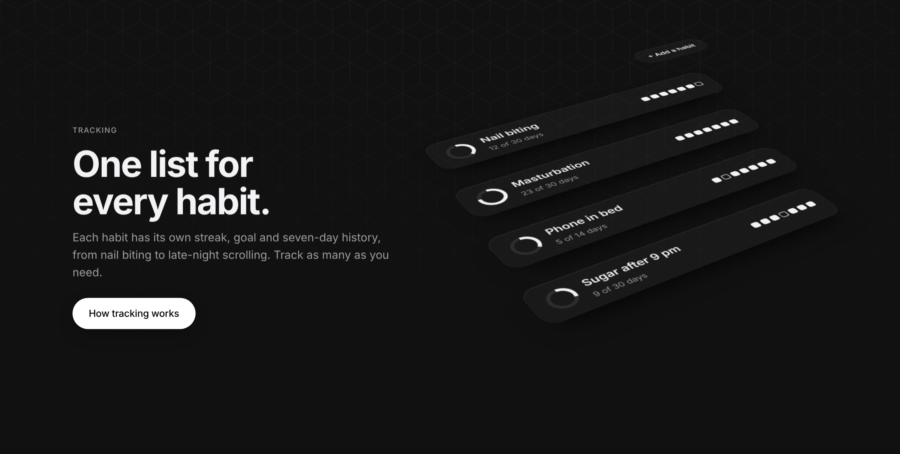
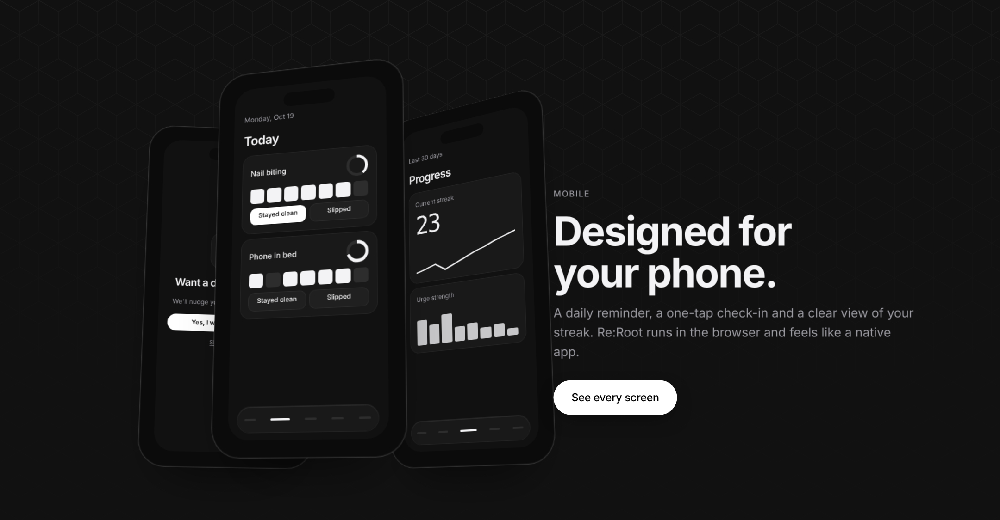
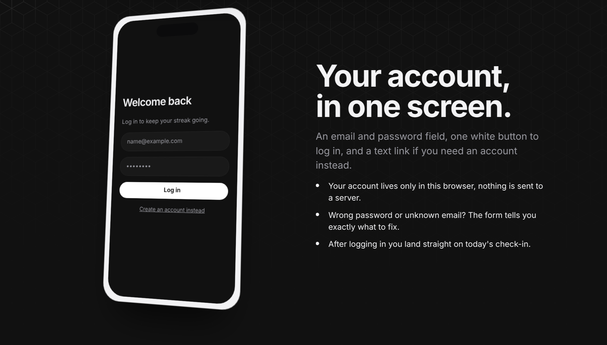
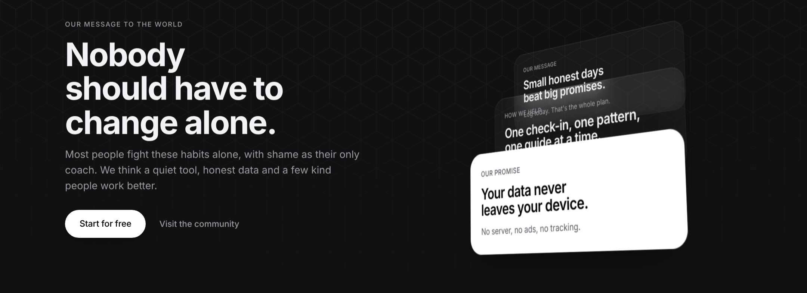

# Re:Root

**Take control of your habits.**

Re:Root is a private habit tracker for quitting the things you keep going back to, like nail biting, porn, smoking or late-night scrolling. You check in once a day, see your streaks and patterns, and open a short guide when an urge hits.

Live site: https://denysovski.github.io/ReRoot/

> Demo project. Accounts, reminders and the community chat are simulated in the browser. Nothing is sent to a server.

## What's inside

- **Daily check-in**: "Stayed clean" or "Slipped", an urge rating from 0 to 5 and a short note.
- **Goals**: a target streak per habit and milestones from 1 to 365 days.
- **Progress**: streak line, urge bars and a 12-week calendar.
- **Read**: a breathing exercise and short guides on urges, triggers and slips.
- **Community**: anonymous rooms per habit. Messages disappear after 10 minutes.
- **Reminders**: real browser notifications at a time you choose.

## Style

The design is inspired by **Apple**: its calm, monochrome product pages, the translucent materials in iOS and macOS, and the ideas from Apple's WWDC talk *Designing Fluid Interfaces*.

### Colours

The site is black and white only. The default is a dark coal theme, with a light theme and an automatic mode in the menu.

- Background: `#111111` (coal)
- Cards: `#191919`, raised fields `#202020`
- Lines and empty states: `#2D2D2D`
- Secondary text: `#9B9BA2`
- Main text: `#F3F3F5`
- Actions: pure white `#FFFFFF` with black text

White is saved for the next thing to tap. A positive action is always a **white pill button**. Skipping or a secondary action is always **plain text** that gets an underline on hover.

### Hexagon background

A thin hexagon pattern (white lines at about 6% opacity) covers the background. It is strongest at the top of the page and fades toward the bottom. Around the mouse cursor the hexagon lines light up softly, brightest right under the pointer and fading out within about 190 px.

### Glass over soft light

Navigation, menus, cards and tooltips are frosted glass: a semi-transparent surface with a background blur, a thin light edge and a soft shadow. This comes from Apple's translucent materials, the layered glass you see in iOS and macOS bars and sheets. Cards also tilt slightly toward the mouse and catch a soft highlight where the pointer is.

### Fluid motion

Motion follows Apple's *Designing Fluid Interfaces* principles:

- Every animation is a **spring** (response and damping) instead of a fixed duration, so it can be interrupted and reversed at any moment.
- Buttons react the instant you press them, not on release.
- The bottom sheet in the app follows your finger, stretches with resistance at the edge and keeps your release speed when it closes.
- Content slides in from the left and right, or rises toward you from depth, as you scroll.
- The navigation bar zooms out while scrolling down and back in when scrolling up.
- With "reduce motion" switched on, everything appears instantly instead.

### 3D scenes

Real CSS 3D (perspective and `preserve-3d`), no images or libraries. Each scene tilts toward the mouse, floats gently when idle, and returns smoothly 1.5 seconds after the mouse leaves.

- **Calendar** on the homepage: clean days raised off the page, today floating highest, with streak, check-in and urge chips around it.
- **Habit list**: a stack of habit rows with streak rings and a week of check-ins, which spreads apart on hover.

- **Phones**: three app screens (reminder, Today, Progress) fanned out in space.

- **Showcase**: every app screen on its own tilted phone, with a white frame in dark mode.

- **About**: three stacked message cards in perspective, plus team portraits angled left and right.

### Type

[Geist](https://vercel.com/font) for everything, Geist Mono for numbers. Headings are large and tightly spaced, body text is calm and grey.

## Pages

- `/`: homepage
- `/how-it-works`: the five steps
- `/showcase`: every app screen, explained
- `/community`: chat rooms
- `/articles` and `/articles/<id>`: guides
- `/about`: mission, team and partners
- `/faq`, `/contact`, `/terms`, `/privacy`
- `/register`, `/login`, `/onboarding`
- `/app`, `/app/today`, `/app/progress`, `/app/goals`, `/app/read`: the tracker

It is a single-page app with clean URLs, built with plain HTML, CSS and JavaScript, with no framework and no build step. Everything is stored in your browser's local storage.

## Disclaimer

Re:Root is a self-tracking tool, not medical care. If a habit is harming your health, talk to a doctor or therapist.
