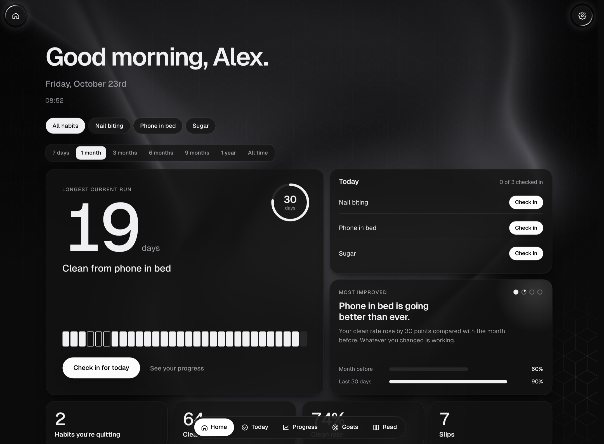
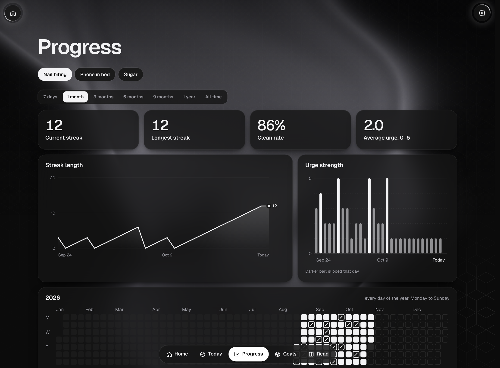
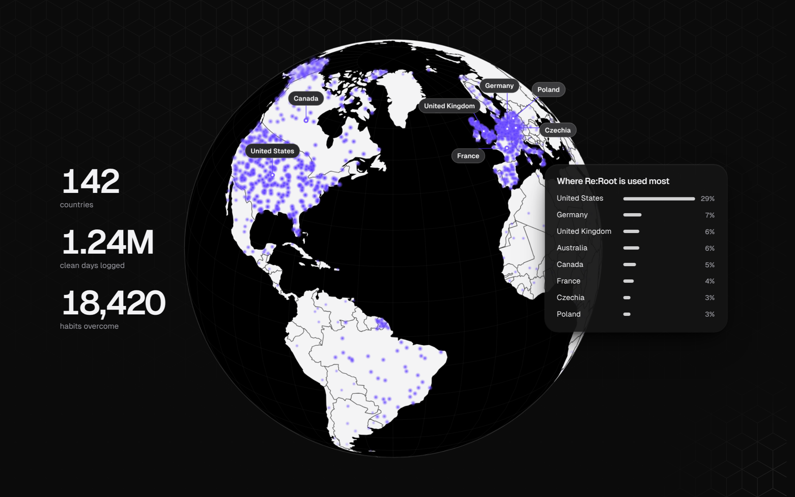
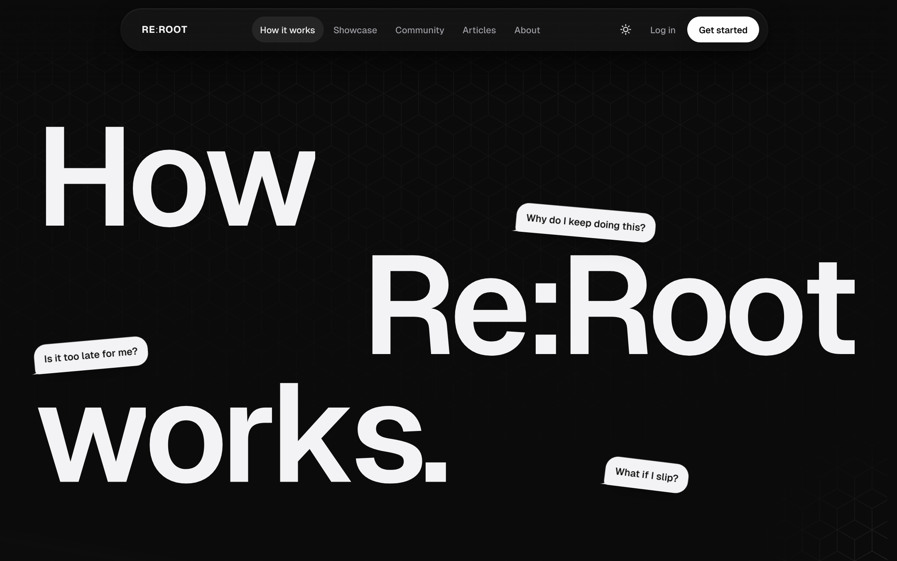

# Re:Root

**Take control of your habits.**

Re:Root is a private habit tracker for quitting the things you keep going back to, like nail biting, porn, smoking or late-night scrolling. You check in once a day, see your streaks and patterns, and open a short guide when an urge hits.

Live site: https://denysovski.github.io/ReRoot/

> Demo project. Accounts and reminders are simulated in the browser, and community figures and stories are illustrative. Nothing is sent to a server.

*Screenshots show the default dark coal theme. A light theme and an automatic mode are in the menu.*

## What's inside

- **Home dashboard**: your longest current run with a goal ring, filters by habit and by period (7 days to all time), a streak chart that marks every slip and the peak before it, a weekday chart of when slips happen, and rotating insight cards (consistency, most improved habit, how often you slip, whether urges are getting weaker).
- **Daily check-in**: "Stayed clean" or "Slipped" and an urge rating from 0 to 5. Missed a day? Tap it in the week row and log the last 7 days.
- **Diary**: an optional entry for each day, saved with the time you wrote it, with a history of every day.
- **Progress**: current and longest streak, clean rate, average urge, streak and urge charts, the whole year as a calendar and a list of the days you slipped.
- **Goals**: a target streak per habit, with editing, sharing and reminders in each habit's settings.
- **Read**: a breathing exercise (4 · 4 · 6) and short guides on urges, triggers and slips.
- **Reminders**: real browser notifications with a sound, at a time you choose.
- **Community**: a 3D globe of where people use Re:Root, check-in times and the habits people are beating.

## Style

The design is inspired by **Apple**: its calm, monochrome product pages, the translucent materials in iOS and macOS, and the ideas from Apple's WWDC talk *Designing Fluid Interfaces*.

### Colours

The site is black and white only. The default is a dark coal theme, with a light theme and an automatic mode in the menu.

- Background: `#0B0B0B` (coal black)
- Cards: `#141414`, raised fields `#1A1A1A`
- Lines and empty states: `#282828`
- Secondary text: `#9B9BA2`
- Main text: `#F3F3F5`
- Actions: pure white `#FFFFFF` with black text

White is saved for the next thing to tap. A positive action is always a **white pill button**. Skipping or a secondary action is always **plain text** that gets an underline on hover.

### Hexagon background

A thin hexagon pattern (white lines at about 6% opacity) covers the background. It is strongest at the top of the page and fades toward the bottom. Around the mouse cursor the hexagon lines light up softly, brightest right under the pointer and fading out within about 270 px.

### Glass over soft light

Navigation, menus, cards and tooltips are frosted glass: a semi-transparent surface with a background blur, a thin light edge and a soft shadow. This comes from Apple's translucent materials, the layered glass you see in iOS and macOS bars and sheets. Cards also tilt slightly toward the mouse and catch a soft highlight where the pointer is.

### Fluid motion

Motion follows Apple's *Designing Fluid Interfaces* principles:

- Every animation is a **spring** (response and damping) instead of a fixed duration, so it can be interrupted and reversed at any moment.
- Buttons react the instant you press them, not on release.
- The bottom sheet in the app follows your finger, stretches with resistance at the edge and keeps your release speed when it closes.
- Content slides in from the left and right, or rises toward you from depth, as you scroll.
- The navigation bar zooms out while scrolling down and back in when scrolling up.
- With "reduce motion" switched on, everything appears instantly instead.

### 3D scenes

Real CSS 3D (perspective and `preserve-3d`), no images or 3D libraries. Each scene tilts toward the mouse, floats gently when idle, and returns smoothly 1.5 seconds after the mouse leaves.

- **Calendar** on the homepage: clean days raised off the page, today floating highest, with streak, check-in and urge chips around it.
- **Habit list**: a stack of habit rows with streak rings and a week of check-ins, which spreads apart on hover.

- **Phones**: three app screens (reminder, Today, Progress) fanned out in space.

- **Showcase**: every app screen on its own tilted phone, with a white frame in dark mode.

- **About**: three stacked message cards in perspective, plus team portraits angled left and right.

- **Community globe**: a rotating, draggable globe drawn with d3-geo, with labelled countries and a dot for every group of users.

### Text effects

- **How it works**: the title words fly in from both sides, letters roll like a slot machine as you scroll, and question bubbles pop out of a dot.
- **Homepage title**: letters get heavier as the cursor comes near (variable font weight).
- **About title**: a soft band of light sweeps across the text and follows the cursor on hover.

### Type

[Geist](https://vercel.com/font) for everything, Geist Mono for numbers. Headings are large and tightly spaced, body text is calm and grey.

## Pages

- `/`: homepage
- `/how-it-works`: the five steps
- `/showcase`: every app screen, explained
- `/community`: the globe and community stats
- `/articles` and `/articles/<id>`: guides
- `/about`: mission, team and partners
- `/faq`, `/contact`
- `/terms`, `/privacy`, `/medical-disclaimer`: legal pages
- `/register`, `/login`, `/onboarding`
- `/app`, `/app/today`, `/app/progress`, `/app/goals`, `/app/read`: the tracker

It is a single-page app with clean URLs, built with plain HTML, CSS and JavaScript, with no framework. Every public URL also exists as its own static page with a title, description, canonical link, Open Graph tags and structured data, so search engines can index it. A `sitemap.xml` and `robots.txt` are included.

## Privacy and security

Everything is stored in your browser's local storage. There is no server or database, so nothing you log is sent anywhere. Passwords are hashed with PBKDF2 and a random salt, repeated failed logins are slowed down, and every page has a strict Content-Security-Policy. See [SECURITY.md](SECURITY.md).

## Disclaimer

Re:Root is a self-tracking tool, not medical care. If a habit is harming your health, talk to a doctor or therapist. Read the full [medical disclaimer](https://denysovski.github.io/ReRoot/medical-disclaimer/).
